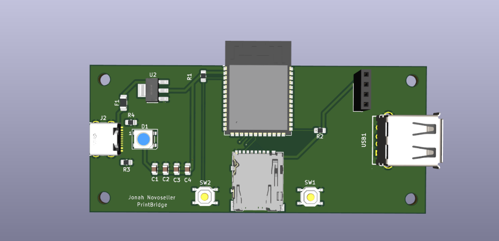
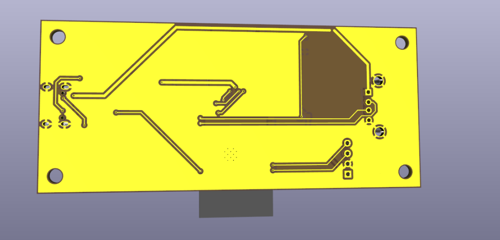
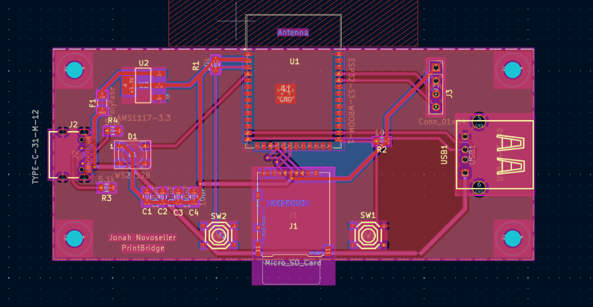
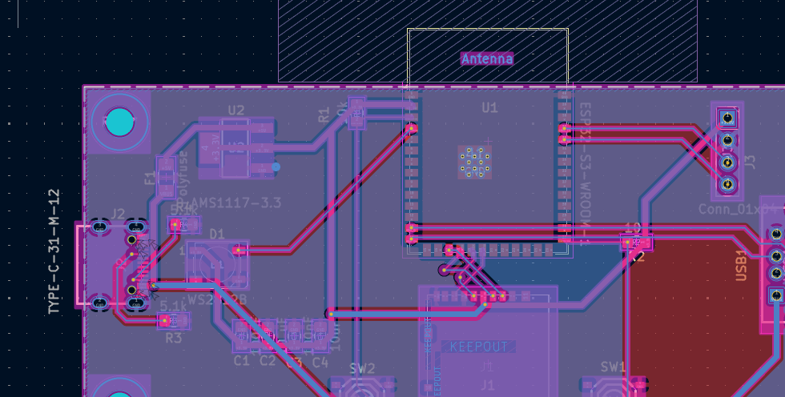
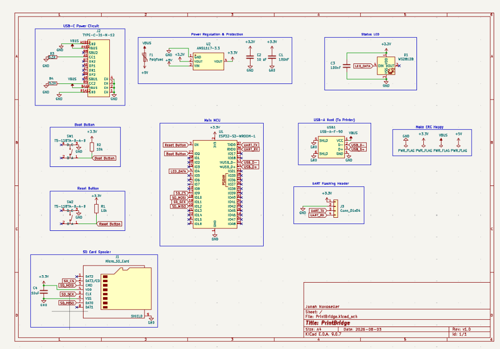

# PrintBridge

Im so done with needing to unplug all my cords and plug it all in ontip of a file of boxes to print one god damn thing so i made my wired printer wireless

## what is this thing

A small, cheap PCB that turns a wired USB printer into a WiFi network printer. It plugs into the printer's USB port as a USB **Host**, and exposes it on the network via raw JetDirect (port 9100) printing — works natively with macOS/Windows/Linux print dialogs, no drivers needed on the printer side.

Print jobs get spooled to the onboard micro SD card first, so if your wifi drops mid-print the job is safe and keeps going. because my wifi used to be *that* bad.

## pcb layout

## schematic

## specs

- ESP32-S3-WROOM-1 module — WiFi + native USB Host on one chip
- USB-A host port to connect to the printer
- USB-C for power input (5V only, no data)
- Micro SD card slot for print job spooling
- WS2812B addressable RGB status LED
- BOOT and RESET tactile switches
- 1x4 UART header for firmware flashing (with an external USB-serial adapter)
- AMS1117-3.3 voltage regulator with polyfuse protection
- FCC/CE modular certification inherited from the WROOM-1 module
- Board size: ~55 x 28mm

## how it works

1. plug PrintBridge into your printer's USB port
2. power it with any USB-C charger
3. it connects to your WiFi and starts listening on port 9100
4. add it as a network printer on your computer (raw/JetDirect protocol)
5. print! the job gets spooled to the SD card first, then fed to the printer

## wiring

**USB-C power in (J2):** 5V power only, no data lines connected. CC1/CC2 have 5.1k pull-downs so any USB-C charger recognizes it as a power sink. goes through a polyfuse for overcurrent protection, then into the AMS1117-3.3 regulator.

**USB-A host (USB1):** D+ and D- are wired to the ESP32-S3's USB PHY (GPIO19/GPIO20). VBUS gets raw 5V from the power rail — host mode has to supply power to the printer.

**SD card (J1):** SPI connection to the ESP32-S3 for spooling print data before sending to the printer.

**Status LED (D1):** WS2812B addressable LED. blue=booting, yellow=connecting, green=ready, cyan=receiving, purple=printing, red=error.

**Flashing:** no onboard USB-serial chip to keep costs down. use an external ~$3 USB-to-UART dongle on the 4-pin UART header (J3: 3V3/GND/TX/RX).

## BOM

every part has an LCSC part number and link so anyone can source and build this.

| Ref | Qty | Value | LCSC # | Package | Description | Unit Price | Subtotal | Link |
|-----|-----|-------|--------|---------|-------------|------------|----------|------|
| U1 | 1 | ESP32-S3-WROOM-1-N8 | C2913198 | Module | ESP32-S3 WiFi/BLE module (8MB flash) | $2.88 | $2.88 | [LCSC](https://www.lcsc.com/product-detail/C2913198.html) |
| USB1 | 1 | USB-A-F-90 | C168708 | Through-hole | USB-A host receptacle (to printer) | $0.15 | $0.15 | [LCSC](https://www.lcsc.com/product-detail/C168708.html) |
| J2 | 1 | TYPE-C-31-M-12 | C165948 | SMD | USB-C power input | $0.10 | $0.10 | [LCSC](https://www.lcsc.com/product-detail/C165948.html) |
| U2 | 1 | AMS1117-3.3 | C6186 | SOT-223 | 3.3V linear regulator | $0.05 | $0.05 | [LCSC](https://www.lcsc.com/product-detail/C6186.html) |
| SW1, SW2 | 2 | TS-1187A-B-A-B | C318884 | SMD | Tactile switches (BOOT + RESET) | $0.02 | $0.04 | [LCSC](https://www.lcsc.com/product-detail/C318884.html) |
| J1 | 1 | DM3AT-SF-PEJM5 | C114218 | SMD | Micro SD card connector | $0.65 | $0.65 | [LCSC](https://www.lcsc.com/product-detail/C114218.html) |
| D1 | 1 | WS2812B | C2761795 | 5050 | Addressable RGB status LED | $0.08 | $0.08 | [LCSC](https://www.lcsc.com/product-detail/C2761795.html) |
| R1, R2 | 2 | 10k | C269742 | 0805 | Pull-up resistors (EN + BOOT) | $0.01 | $0.02 | [LCSC](https://www.lcsc.com/product-detail/C269742.html) |
| R3, R4 | 2 | 5.1k | C269748 | 0805 | USB-C CC pull-down resistors | $0.01 | $0.02 | [LCSC](https://www.lcsc.com/product-detail/C269748.html) |
| C1, C3 | 2 | 100nF | C38141 | 0805 | Decoupling capacitors | $0.01 | $0.02 | [LCSC](https://www.lcsc.com/product-detail/C38141.html) |
| C2 | 1 | 10uF | C92341 | 0805 | Bulk capacitor (3V3 rail) | $0.02 | $0.02 | [LCSC](https://www.lcsc.com/product-detail/C92341.html) |
| C4 | 1 | 10uF | C92341 | 0805 | Bulk capacitor (SD card) | $0.02 | $0.02 | [LCSC](https://www.lcsc.com/product-detail/C92341.html) |
| F1 | 1 | Polyfuse 500mA | C106264 | 1206 | PTC resettable fuse | $0.07 | $0.07 | [LCSC](https://www.lcsc.com/product-detail/C106264.html) |
| J3 | 1 | Conn_01x04 | — | 2.54mm | UART pin header (for flashing) | $0.05 | $0.05 | [LCSC](https://www.lcsc.com/search?q=1x4+2.54mm+pin+header) |

**total: 18 parts — ~$4.17**

## firmware

the firmware is in the `software/` folder. its a PlatformIO project (Arduino framework). wifi, SD spooling, and the TCP print server are working. USB host printer driver is WIP.

see [software/README.md](software/README.md) for build and flash instructions.

## references

- [Espressif KiCad Libraries](https://github.com/espressif/kicad-libraries) — official symbols, footprints, 3D models
- [ESP32S3_PrintServer](https://github.com/MAXXTANG/ESP32S3_PrintServer) — reference firmware for ESP32-S3 print bridge
- [EspUsbHost](https://github.com/tanakamasayuki/EspUsbHost) — Arduino USB Host library for ESP32-S3

## license

do whatever you want with it honestly

---

made by Jonah Novoseller (Kingdragoncat)
